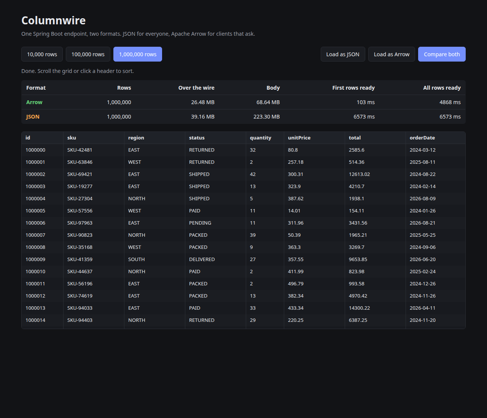

<h1 align="center">Columnwire</h1>

<p align="center">
  <b>Apache Arrow from Spring Boot to React. Same endpoints, columnar bytes instead of JSON.</b>
</p>

<p align="center">
  <a href="https://github.com/DHARANEESH-SRINIVASAN/columnwire/actions/workflows/ci.yml"></a>
  <a href="https://central.sonatype.com/artifact/io.github.dharaneesh-srinivasan/columnwire-spring-boot-starter"></a>
  <a href="https://www.npmjs.com/package/columnwire"></a>
  <a href="https://www.npmjs.com/package/columnwire"></a>
  <a href="LICENSE"></a>
  <br/>
  <a href="https://www.bestpractices.dev/projects/16203"></a>
  <a href="https://www.bestpractices.dev/projects/16203"></a>
  <a href="https://scorecard.dev/viewer/?uri=github.com/DHARANEESH-SRINIVASAN/columnwire"></a>
  <a href="https://github.com/DHARANEESH-SRINIVASAN/columnwire/actions/workflows/codeql.yml"></a>
  <a href="https://www.npmjs.com/package/columnwire"></a>
</p>

<p align="center">
  <a href="https://dharaneesh-srinivasan.github.io/columnwire/"><b>▶ Try the live demo</b></a> · 300,000 rows as JSON and as Arrow, fetched and decoded in your browser
</p>

<p align="center">
  
</p>

Most Java backends send tables to React as JSON. The server turns every value into text, the browser parses it back into one object per row, and the grid has to wait for the last byte before it can show the first row. At a hundred thousand rows that wait is visible. At a million it is several seconds and a quarter of a gigabyte of heap.

Columnwire keeps your endpoints exactly as they are and adds a second representation. A client that sends `Accept: application/vnd.apache.arrow.stream` gets [Apache Arrow](https://arrow.apache.org/) record batches, streamed as they are encoded. Every other client keeps getting JSON. On the React side, a hook and a virtualized grid read the columns straight out of the Arrow buffers, so no row objects are ever built.

```
┌──────────────┐   Accept: application/vnd.apache.arrow.stream   ┌──────────────────────────────┐
│ React        │ ─────────────────────────────────────────────▶  │ Spring Boot                  │
│ useArrow()   │                                                  │ @GetMapping List<Order> ...  │
│ <ArrowGrid/> │ ◀── batch 1 ── batch 2 ── ... ── batch n ─────── │ columnwire-spring-boot-starter│
└──────────────┘     rows on screen after the first batch         └──────────────────────────────┘
        curl, mobile apps, other services: no Arrow in Accept ─▶ the same endpoint answers with JSON
```

## Results

Measured on one machine (Intel i7-1255U, 12 threads, 31 GB, Ubuntu, JDK 25.0.5, Node 22.23.3, Chrome headless). Each record has 11 fields: ids, SKUs, two enums, quantities, prices, a date, an instant, a nullable customer and a flag. Numbers vary by machine, so every one of them can be reproduced with the commands below.

**Server: encoding in Spring Boot** (JMH, average of 6 iterations after 4 warmups, against Jackson 3, the JSON library Spring Boot 4 uses)

| Rows | Jackson JSON | Columnwire Arrow | Garbage per response, JSON → Arrow |
|---:|---:|---:|---:|
| 10,000 | 6.28 ms | **1.46 ms** (4.3×) | 5.3 MB → 0.6 MB |
| 100,000 | 67.4 ms | **14.4 ms** (4.7×) | 52.8 MB → 5.9 MB |
| 1,000,000 | 643 ms | **154 ms** (4.2×) | 576 MB → 58 MB |

**Payload size**

| Rows | JSON | Arrow | JSON, gzip | Arrow, gzip |
|---:|---:|---:|---:|---:|
| 10,000 | 2.23 MB | **0.69 MB** | 0.39 MB | **0.27 MB** |
| 1,000,000 | 223 MB | **68.7 MB** (3.2× smaller) | 39.2 MB | **27.2 MB** (1.4× smaller) |

JSON compresses well, so with gzip on the size gap is 1.4×, not 3.2×. The larger wins are in the next two tables.

**Browser engine: decoding** (V8, median; Arrow decoding is zero-copy, values are read from the buffer when accessed)

| Rows | Decode JSON | Decode Arrow | First 30 rows ready, JSON | First 30 rows ready, Arrow | Memory held, JSON | Memory held, Arrow |
|---:|---:|---:|---:|---:|---:|---:|
| 10,000 | 8.98 ms | **0.92 ms** | 7.74 ms | **0.97 ms** | 2.4 MB | **0.7 MB** |
| 100,000 | 95.1 ms | **2.15 ms** | 95.6 ms | **1.94 ms** | 23.8 MB | **7.0 MB** |
| 1,000,000 | 1,213 ms | **7.23 ms** | 1,244 ms | **9.91 ms** | 238.5 MB | **69.7 MB** |

"Memory held, Arrow" includes the response buffer itself, which the table keeps alive.

**End to end in Chrome** (the demo below, Spring Boot with gzip on, 1,000,000 rows)

| | JSON (`fetch().json()`) | Arrow (`fetchArrow`) |
|---|---:|---:|
| Over the wire | 39.16 MB | **26.48 MB** |
| First rows on screen | 6,573 ms | **103 ms** |
| All rows loaded | 6,573 ms | **4,868 ms** |

The headline is the first-paint number: the grid starts drawing after the first batch of 16,384 rows instead of after the last byte.

## Quick start

### Spring Boot

```xml
<dependency>
  <groupId>io.github.dharaneesh-srinivasan</groupId>
  <artifactId>columnwire-spring-boot-starter</artifactId>
  <version>0.1.1</version>
</dependency>
```

Arrow reads off-heap memory, so the JVM needs one flag (add `--sun-misc-unsafe-memory-access=allow` as well on Java 24 and newer to silence a deprecation warning):

```
--add-opens=java.base/java.nio=ALL-UNNAMED
```

Your controllers do not change:

```java
public record Order(long id, String sku, Region region, double total, LocalDate orderDate, Instant createdAt) {}

@GetMapping("/api/orders")
Stream<Order> orders() {
    return repository.streamAll();
}
```

`List`, `Stream`, `Iterable`, arrays and `ResponseEntity` of records all work. Rows are encoded in batches as they are pulled from the `Stream`, so a large result is never held twice in memory.

### React

```sh
npm install columnwire apache-arrow
```

```tsx
import { useArrow, ArrowGrid } from "columnwire/react";

export function Orders() {
  const { table, status, rows, error } = useArrow("/api/orders");
  if (error) return <p>{error.message}</p>;
  return (
    <>
      <p>{status === "streaming" ? `Loading… ${rows.toLocaleString()} rows` : `${rows.toLocaleString()} rows`}</p>
      <ArrowGrid table={table} height={520} />
    </>
  );
}
```

Without React, `fetchArrow(url, { onBatch })` returns an Arrow `Table` and reports each batch as it lands. The client asks for `application/vnd.apache.arrow.stream, application/json;q=0.5`, so it also works against a backend that does not have the starter yet: JSON is turned into the same `Table`.

## How it behaves

- **Only on request.** The Arrow converter is appended after Spring's own converters, so `Accept: */*`, browsers, `curl` and axios defaults keep getting JSON. Clients have to ask for Arrow explicitly, and quality values (`q=`) are honoured.
- **Cache-safe.** Every endpoint that can answer in both formats sends `Vary: Accept`, on the JSON responses as well, so a shared cache never hands one client the other's format.
- **Honest failures.** A body Arrow cannot represent (a single object, a record with a nested list) gets `406 Not Acceptable` for Arrow and still serves JSON. A JVM without the flag above fails at startup with the exact flag to add, instead of a cryptic error on the first request.
- **Streaming.** Records are written in batches of `columnwire.batch-size` (default 8192). The browser can render batch one while the server is still encoding batch two.
- **Same names as your JSON.** Jackson's `@JsonProperty` renames and `@JsonIgnore` are respected, so column names match the JSON your clients already know.
- **Enums are dictionaries.** An enum column is sent as one-byte indices plus a dictionary of its constants, which the browser decodes back to strings.

| Java | Arrow | JavaScript value |
|---|---|---|
| `boolean`, `Boolean` | Bool | `boolean` |
| `byte`, `short`, `int` and boxes | Int8, Int16, Int32 | `number` |
| `long`, `Long` | Int64 | `bigint` |
| `float`, `double` and boxes | Float32, Float64 | `number` |
| `String`, `char`, `UUID`, `BigInteger` | Utf8 | `string` |
| `BigDecimal` | Utf8 (plain string, lossless) | `string` |
| `enum` | Dictionary of Utf8 | `string` |
| `LocalDate` | Date32 | `number` (epoch ms) |
| `LocalDateTime` | Timestamp µs | `number` (epoch ms) |
| `Instant`, `OffsetDateTime`, `ZonedDateTime` | Timestamp µs, UTC | `number` (epoch ms) |
| `LocalTime` | Time64 µs | `bigint` |

Primitive components are non-nullable columns. Everything else is nullable.

### Configuration

| Property | Default | |
|---|---|---|
| `columnwire.enabled` | `true` | Set to `false` to remove the converter entirely |
| `columnwire.batch-size` | `8192` | Rows per Arrow record batch |

A note for anyone wiring Arrow into Spring by hand: on Java 24 and newer, Arrow's Netty allocator (`arrow-memory-netty`) fails with a `ClassCastException` because Netty turns off its `Unsafe` path there. Columnwire uses `arrow-memory-unsafe`, which works on Java 17 through 25.

## The grid

`ArrowGrid` renders only the rows in view, plus a few above and below. It reads each visible cell with `vector.get(row)` and never materializes the table. It stays usable past the browsers' maximum element height by scaling the scroll range, so the last of two million rows is still reachable. Clicking a header sorts the whole column (numbers, dates and timestamps sort on the typed array directly), clicking again reverses, and a third click clears. It exposes `role="grid"`, `aria-rowcount` and `aria-sort`, and takes `columns`, `columnWidths`, `format` and CSS variables (`--cw-border`, `--cw-header-bg`, `--cw-row-alt`) for styling.

## Run it yourself

The [live demo](https://dharaneesh-srinivasan.github.io/columnwire/) runs on static files that CI encodes with `columnwire-core` on every push. To run it against a real Spring Boot server, which streams batches while it encodes them:

```sh
mvn -pl columnwire-example -am install -DskipTests
mvn -pl columnwire-example spring-boot:run
cd js && npm install && npm run dev -w columnwire-demo
```

Open http://localhost:5173 and press **Compare both**.

Benchmarks:

```sh
mvn -pl columnwire-benchmark -am package -DskipTests
cd columnwire-benchmark
mvn -q dependency:build-classpath -Dmdep.outputFile=target/cp.txt
java -cp "target/classes:$(cat target/cp.txt)" org.openjdk.jmh.Main EncodeBenchmark -prof gc
java --add-opens=java.base/java.nio=ALL-UNNAMED -cp "target/classes:$(cat target/cp.txt)" \
  io.github.dharaneeshsrinivasan.columnwire.benchmark.PayloadSizes target/payloads
cd ../js && node --expose-gc --max-old-space-size=6000 bench/parse.mjs ../columnwire-benchmark/target/payloads
```

Raw results from the runs above are in [`docs/`](docs).

## Tests

- **Core:** round-trips every supported type through Arrow's own Java reader, checks batch splitting, empty streams, Jackson renames, and that no off-heap memory leaks.
- **Starter:** runs against a real Tomcat on a random port: Arrow on request; JSON for `*/*`, browser and axios `Accept` headers; quality values; `Stream`, arrays and `ResponseEntity`; 50,000 rows in 50 batches; `406` for bodies Arrow cannot represent; `Vary` on both formats; the disabled switch.
- **Contract:** a fixture written by the Java encoder is decoded in JavaScript and compared value for value with Jackson's JSON for the same records, down to microsecond timestamps.
- **JS:** streaming in 97-byte chunks, the JSON fallback, aborts on unmount, reading the response to the end, windowed rendering, sorting, and the two-million-row scroll cap.

CI runs the Java suite on JDK 17, 21 and 25 and the JS suite on Node 22.

## Limits and roadmap

- Records only for now. JavaBeans, `Map` rows from `JdbcTemplate.queryForList` and JDBC `ResultSet` streaming are next.
- Nested records, lists and maps are not encoded yet (those bodies get `406` for Arrow and stay JSON).
- Responses only. Arrow request bodies are not read.
- Spring MVC only. WebFlux support would stream `Flux<Record>`.
- Low-cardinality `String` columns could be dictionary-encoded per batch for smaller payloads.

## Layout

```
columnwire-core/                  records → Arrow IPC stream, schema cache, type mapping
columnwire-spring-boot-starter/   HttpMessageConverter, auto-configuration, Vary advice
columnwire-benchmark/             JMH benchmark, payload sizes, cross-language fixtures
columnwire-example/               Spring Boot app used by the demo
js/packages/columnwire/           fetchArrow, useArrow, ArrowGrid (npm: columnwire)
js/demo/                          Vite + React comparison page
js/bench/                         V8 decode benchmark
```

## Security and verification

Report vulnerabilities privately, as described in [SECURITY.md](SECURITY.md). Every release can be checked independently:

```sh
gpg --keyserver keys.openpgp.org --recv-keys B9F051CF9545B2AB72829518908A18CEE22E2846
gpg --verify columnwire-spring-boot-starter-0.1.1.jar.asc columnwire-spring-boot-starter-0.1.1.jar
npm audit signatures
```

Since 0.1.1, release jars and the npm tarball also carry GitHub build-provenance attestations (`gh attestation verify <file> -R DHARANEESH-SRINIVASAN/columnwire`). Contributions are welcome: see [CONTRIBUTING.md](CONTRIBUTING.md) and the [changelog](CHANGELOG.md).

## License

Apache License 2.0. Built by [Dharaneesh S](https://github.com/DHARANEESH-SRINIVASAN).
